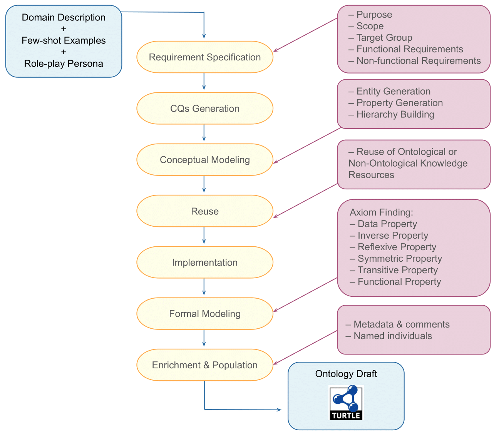
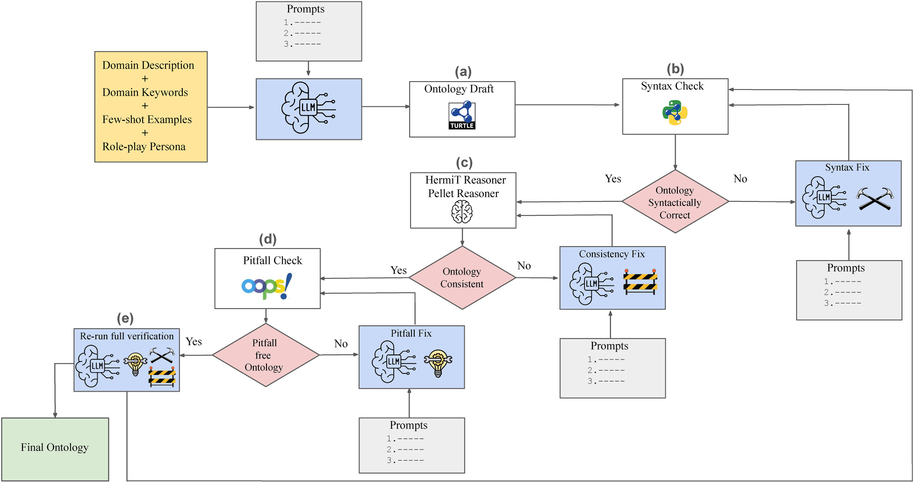
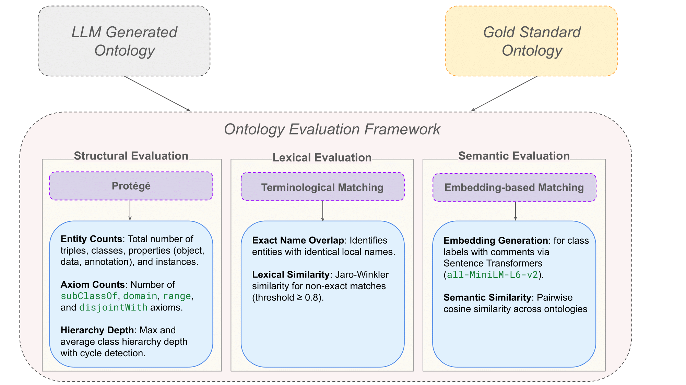

# Extended NeOn-GPT: Advancing LLM-Powered Ontology Learning Through Ontology Reuse and Automated Verification

Large Language Models (LLMs) offer promising capabilities for automating ontology engineering tasks; however, existing approaches often focus on isolated knowledge extraction rather than comprehensive ontology construction. In this paper, we present an extended version of NeOn-GPT, a pipeline that integrates prompt-engineered LLM interactions within the structured NeOn ontology engineering methodology. Building on our prior work, we enhance the pipeline with improved prompting strategies, support for ontology reuse, and more robust validation mechanisms. We apply the updated pipeline across four domains—wine, sewer networks, cheminformatics, and environmental microbiology—using both proprietary (GPT-4o) and open-source (Mistral, Deepseek, Llama) LLMs to evaluate model and domain generalization. The resulting ontologies are assessed against expert-curated gold standards using structural, lexical, and semantic metrics. Our results highlight the domain-specific strengths and limitations of different LLMs, revealing that while models can capture relevant concepts and properties (relations), challenges remain in lexical alignment, hierarchical depth, and semantic precision. This work presents a comprehensive framework for evaluating LLM-based ontology generation, offering practical insights to enhance the quality and scalability of ontology learning pipelines.  The process involves the following stages: 

 ✍️ **1. Ontology Draft Generation**

This stage begins with structured inputs: a domain description, a curated set of few-shot examples, and a carefully crafted role-play persona that primes the LLM to act as a domain expert. Guided by these inputs, the model is prompted to define the ontology’s purpose, scope, and intended users, which leads to the generation of competency questions—natural language queries that the final ontology should be able to answer. The LLM extracts key domain entities and relations from these questions, building a conceptual model with hierarchical class structures. The pipeline then supports reusing existing ontologies by integrating relevant fragments directly into the prompt. Finally, the model enriches this conceptual representation with formal axioms, descriptive metadata, and named individuals. The result of this stage is a complete ontology draft serialized in Turtle syntax. 

<div align="center">
  
</div>

 Figure 1: Ontology draft generation pipeline guided by domain description, few-shot examples, and expert role-play prompting.

 🔁 **2. NeOn-GPT pipeline**

Once the draft is generated, it is passed through a three-stage validation and refinement process: (a) syntax checking using RDFLib, (b) logical consistency verification with OWL reasoners such as HermiT and Pellet, and (c) pitfall detection using the OOPS! Framework. Errors identified by these tools—such as syntax violations, logical inconsistency, or modeling pitfalls—are fed back to the LLM as diagnostic prompts. The model is then prompted to revise and repair the ontology, enabling an iterative refinement loop that produces a syntactically valid, logically consistent, and semantically robust output.

<div align="center">
  
</div>

 Figure 2: Full NeOn-GPT workflow showing ontology generation, validation, and iterative refinement using LLM prompts guided by diagnostic feedback from RDFLib, OWL reasoners, and OOPS!

 

📊 **3. Ontology Evaluation Framework**

We evaluate generated ontologies against expert-developed gold standards using a three-part framework: (a) Structural metrics: Entity counts, hierarchy depth, and axiom coverage; (b) Lexical analysis: Name overlap and string similarity; and (c) Semantic similarity, Embedding-based comparisons via Sentence Transformers.

<div align="center">
  
</div>
Figure 3: Ontology evaluation framework combining structural analysis, lexical matching, and semantic similarity to compare LLM-generated ontologies against expert-developed gold standards.


 **🗂️ Directory Overview**

- **`images/`**: Visual figures used in `README.md`.
- **`domains/`**: The inputs of the experiments for each of the four domains (Wine, CHEMINF, AquaDiva, SewerNet): ontology brief, persona, reuse snippets and few-shot examples. Each domain has a readable `.md` page and a `.json` file with the same content (see [Reproducing the experiments](#-reproducing-the-experiments)).
- **`neon-gpt/`**: Core scripts for ontology generation and validation.
  - **`api_utils.py`**: This script contains utility functions for API communication, especially for working with external services like the OpenRouter API or other APIs used in the project. The functions include sending requests and handling responses.
  - **`ontology_utils.py`**: This script handles ontology-related tasks, primarily for creating and managing Turtle (.ttl) files. It helps with saving and appending Turtle code generated from model responses.
  - **`neon_gpt_ontology_generation.py`**: This script is responsible for generating ontologies using NeOn-GPT methodology.
  - **`validate_fix_ontology_syntax.py`**: This script deals with validating and fixing the syntax of an ontology. It checks for syntactic errors in RDF/OWL files and attempts to repair or reformat the ontology to ensure it adheres to the correct syntax rules using LLM-based correction introduced in the NeOn-GPT methodology. 
  - **`validate_fix_ontology_consistency.py`**: This script is used to validate the consistency of an ontology. This script ensures compatibility with OWL standards. It interacts with reasoners such as HermiT and the ROBOT tool to verify logical coherence and consistency within the ontology. If any inconsistencies are found, the script attempts to automatically correct them using an LLM-based approach introduced in the NeOn-GPT methodology.
  - **`validate_fix_ontology_pitfall.py`**: This script is responsible for detecting and correcting critical ontology modeling pitfalls identified by the OOPS! (Ontology Pitfall Scanner!) framework. It automatically analyzes the generated ontology against common ontology design anti-patterns (e.g., missing domain/range axioms, misuse of equivalence or disjointness, hierarchy anomalies, and incomplete class descriptions).
For each detected pitfall, the script formulates targeted corrective prompts and leverages an LLM to propose refined OWL axioms that resolve the issue while preserving the intended semantics. The corrected axioms are then reintegrated into the ontology, enabling an iterative refinement loop that improves modeling quality beyond syntactic validity and logical consistency.
- **`results/`**:
  - **`gpt-4o-ontologies/`**: Ontologies generated using GPT-4o across multiple domains, including environmental microbiology (AquaDiva), cheminformatics, urban infrastructure (SewerNet), and viticulture (wine).
  - **`mistral-ontologies/`**: Ontologies generated using Mistral across multiple domains, including environmental microbiology (AquaDiva), cheminformatics, urban infrastructure (SewerNet), and viticulture (wine).
  - **`llama4-ontologies/`**: Ontologies generated using Llama4-maverick-17b-128e-instruct across multiple domains, including environmental microbiology (AquaDiva), cheminformatics, urban infrastructure (SewerNet), and viticulture (wine).
  - **`deepseek-ontologies/`**: Ontologies generated using DeepSeek-v3.2-exp across multiple domains, including environmental microbiology (AquaDiva), cheminformatics, urban infrastructure (SewerNet), and viticulture (wine).
  - **`oops-critical-pitfalls/`**: OOPS! reports of the critical pitfalls found in the 16 final ontologies (4 models × 4 domains): each pitfall, its importance and the affected elements. Each report names the ontology it was computed on (`..._syntax_logic_consist_fixed.ttl` in the folders above). Minor and important pitfalls are not listed.
 
- **`eval/`**:
  - **`llm_vs_goldstandard_ontology_analyzer_script.py`**: structural comparison of gold standard ontology and LLM-generated ontology
  - **`semantic_eval.py`**: semantic comparison of gold standard ontology and LLM-generated ontology
  - **`lexical_eval.py`**: lexical comparison of gold standard ontology and LLM-generated ontology

- **`LICENSE`**: Project license.
- **`README.md`**: Project description and usage instructions.


## 🔁 Reproducing the experiments

### Inputs per domain

Each domain's inputs are in `domains/`. They are the same values the pipeline uses: the `ONTOLOGY_CONFIGS` dictionary in `neon-gpt/neon_gpt_ontology_generation.py`.

| Domain | Script key | Readable | Data |
|---|---|---|---|
| Wine | `Wine` | [Wine.md](domains/Wine.md) | [Wine.json](domains/Wine.json) |
| Cheminformatics (CHEMINF) | `CHEMINF` | [CHEMINF.md](domains/CHEMINF.md) | [CHEMINF.json](domains/CHEMINF.json) |
| Environmental microbiology (AquaDiva) | `AquaDiva` | [AquaDiva.md](domains/AquaDiva.md) | [AquaDiva.json](domains/AquaDiva.json) |
| Sewer networks (SewerNet) | `SewerNet` | [SewerNet.md](domains/SewerNet.md) | [SewerNet.json](domains/SewerNet.json) |

### What each input is

| Field | What it is |
|---|---|
| `domain_name`, `domain_description` | The **ontology brief**: what the ontology is about and what it must cover |
| `keywords` | Core terms the model must use |
| `ontology_metrics` | Size of the reference ontology, given to the model as a target ("The original ontology has …") |
| `persona` | The role-play persona that primes the model as a domain expert; it is sent with every step |
| `reuse_example_desc` | Which existing ontologies to reuse, and which parts |
| `few_shot_reuse` | **Reuse snippets**: example triples that link the domain to external vocabularies |
| `few_shot_cqs` | Example competency questions |
| `few_shot_entity_extraction` | Example entities and relations extracted from CQs |
| `few_shot_data_properties` | Example data properties |
| `few_shot_individuals` | Example individuals |

### Which pipeline step uses which input

The persona is sent with every step.

| Step (`step_name`) | Inputs |
|---|---|
| 01 specification | domain name and description, keywords, ontology metrics |
| 02 reuse | reuse description, reuse snippets |
| 03 competency questions | ontology metrics, few-shot CQs |
| 04 entity, relation and axiom extraction | ontology metrics, few-shot entity extraction |
| 05 initial conceptual model | ontology metrics |
| 06–07 extend the conceptual model | keywords, reuse description, reuse snippets |
| 08 Turtle serialization | (previous output only) |
| 09–10 refine the Turtle | reuse description, reuse snippets |
| 11 data properties | ontology metrics, few-shot data properties |
| 12–16 inverse, reflexive, symmetric, functional and transitive properties | ontology metrics |
| 17 individuals | ontology metrics, few-shot individuals |
| 18 metadata, 19 comments | ontology metrics |
| 20 refinement | ontology metrics, reuse description, reuse snippets |

### Run it

1. In `neon-gpt/api_utils.py`, set `API_KEY` to your OpenRouter key. Then set `MODEL` to one of the models used in the paper:
   - `openai/gpt-4o`
   - `mistralai/mistral-large-2512`
   - `meta-llama/llama-4-maverick-17b-128e-instruct`
   - `deepseek/deepseek-v3.2-exp`
2. In `neon-gpt/neon_gpt_ontology_generation.py`, set `SELECTED_ONTOLOGY` to `"Wine"`, `"CHEMINF"`, `"AquaDiva"` or `"SewerNet"`, and run the script. This produces the ontology draft (steps 01–20).
3. Run the validation and repair scripts in order:
   1. `validate_fix_ontology_syntax.py`;
   2. `validate_fix_ontology_consistency.py`;
   3. the OOPS! pitfall repair, `validate_fix_ontology_pitfall.py` (the folder also has `validate_fix_ontology_pitfall_final.py`).

   `results/` keeps each model's ontology after each stage: `_raw` (the draft), `_syntax_fixed`, and `_syntax_logic_consist_fixed` (after syntax and consistency repair). `results/oops-critical-pitfalls/` lists the critical OOPS! pitfalls of the `_syntax_logic_consist_fixed` versions, which are the input to the pitfall repair.
4. Compare the result with the gold standard using the scripts in `eval/`.

To use the inputs without editing the script, load a domain's JSON file. It has the same keys as `ONTOLOGY_CONFIGS[...]`, plus `script_key`.


## 📬 Contact

For inquiries, feel free to contact:
nadeen.fathallah@ki.uni-stuttgart.de


## 📜 License

Code in this repo is licensed under the MIT License.

## 📋 [Read our paper](https://journals.sagepub.com/doi/pdf/10.1177/22104968261453138)

## 📄 Citation

If you find this work useful, please consider citing our paper:

```
@article{fathallah2026extended,
  title={Extended NeOn-GPT: Advancing LLM-Powered Ontology Learning Through Ontology Reuse and Automated Verification},
  author={Fathallah, Nadeen and Das, Arunav and De Giorgis, Stefano and Poltronieri, Andrea and Haase, Peter and Kovriguina, Liubov and Mero{\~n}o-Pe{\~n}uela, Albert and Simperl, Elena and Staab, Steffen and Algergawy, Alsayed},
  journal={Semantic Web},
  volume={17},
  number={4},
  pages={22104968261453138},
  year={2026},
  publisher={SAGE Publications, Sage UK: London, England}
}


